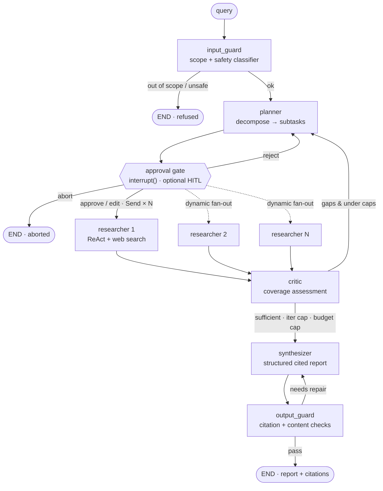
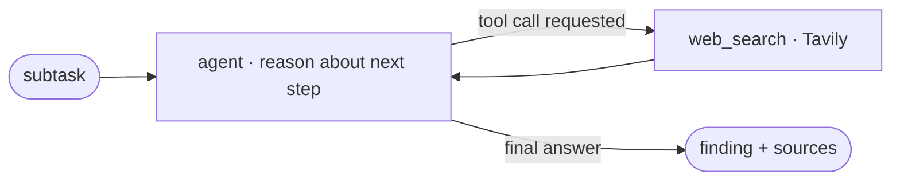
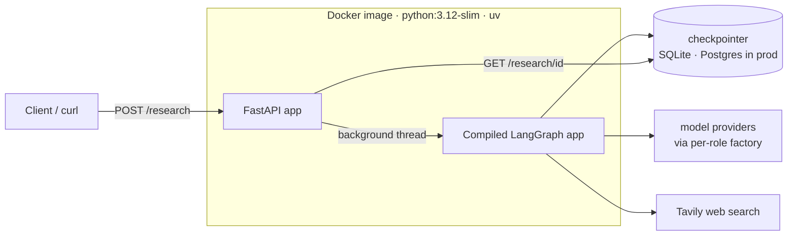

# Deep Research Agent

[](LICENSE)
[](pyproject.toml)
[](https://github.com/langchain-ai/langgraph)

A durable, citation-backed **multi-agent research system** built on **LangGraph** and
shipped as a small **FastAPI** service. Ask it a question; it plans subtasks, fans
out to parallel web-research workers, critiques its own coverage and loops on the
gaps, then synthesizes a report where **every claim is tied to a real source** —
all behind layered input/output guardrails, a hard budget ceiling, and an optional
human-in-the-loop approval gate.

It is deliberately built as a *production-shaped* portfolio piece: observable
(trace tree per run), measurable (LLM-as-judge evals gated in CI), trustworthy
(guardrails + retries), and durable (checkpointed runs that survive restarts and
can pause for a human).



---

## Table of contents

- [What it does](#what-it-does)
- [Capabilities at a glance](#capabilities-at-a-glance)
- [Architecture](#architecture)
- [Tech stack](#tech-stack)
- [Project structure](#project-structure)
- [Design decisions & the *why*](#design-decisions--the-why)
- [Quick start](#quick-start)
- [API contract](#api-contract)
- [Human-in-the-loop](#human-in-the-loop)
- [Configuration](#configuration)
- [Observability](#observability)
- [Evaluation & CI](#evaluation--ci)
- [Run with Docker](#run-with-docker)
- [Testing](#testing)
- [Security & deployment](#security--deployment)
- [License](#license)

---

## What it does

Given a research question, the system runs a **stateful agent graph** rather than a
linear prompt chain:

1. **Input guard** — a cheap classifier rejects out-of-scope or unsafe queries
   *before* any money is spent.
2. **Planner** — decomposes the query into 3–5 focused, non-overlapping subtasks
   using structured output.
3. **Approval gate** *(optional)* — pauses for a human to approve / edit / reject
   the plan before the expensive fan-out. Off by default; the agent is fully
   autonomous unless you turn it on.
4. **Parallel researchers** — one **ReAct** sub-agent per subtask, each with a web
   search tool, all running concurrently. Each returns findings with their sources.
5. **Critic** — assesses whether the aggregated findings actually cover the query.
   If there are gaps (and caps aren't hit), it loops back to the planner with notes.
6. **Synthesizer** — produces a structured report (`summary` + `sections` +
   `citations`) where claims are grounded in the gathered sources.
7. **Output guard** — verifies citations are real and scans for leaked prompts/PII;
   sends the report back for repair if it fails, then ships with flags if needed.

The whole run is **checkpointed after every step**, so it survives process death,
can be resumed, and can pause indefinitely at the human gate.

---

## Capabilities at a glance

This project is structured to demonstrate the full lifecycle of a production GenAI
system, not just a working prototype:

| Capability | Where it lives |
|---|---|
| **Agentic orchestration** — parallel fan-out, bounded reflection loop, nested sub-graphs | [graph.py](src/research_agent/graph.py) |
| **Multi-provider / multi-model** — a different model per role, swappable by env var | [models.py](src/research_agent/models.py), [config.py](src/research_agent/config.py) |
| **RAG-style grounding & attribution** — tool-using researchers + cited synthesis | [nodes/researcher.py](src/research_agent/nodes/researcher.py), [nodes/synthesizer.py](src/research_agent/nodes/synthesizer.py) |
| **Layered guardrails & governance** — input scope/safety, output citation/PII, budget ceiling, retries | [guardrails.py](src/research_agent/guardrails.py), [nodes/guardrails.py](src/research_agent/nodes/guardrails.py) |
| **LLMOps: evaluation + CI gate** — LLM-as-judge metrics fail the PR on regression | [evals/judges.py](evals/judges.py), [.github/workflows/evals.yml](.github/workflows/evals.yml) |
| **Observability** — full trace tree per run via LangSmith / OpenTelemetry | env-driven (see [Observability](#observability)) |
| **Durability + human-in-the-loop** — checkpointer, pause/resume, approval gate | [persistence.py](src/research_agent/persistence.py), [nodes/approval.py](src/research_agent/nodes/approval.py) |
| **Production deployment** — FastAPI start-then-poll API, reproducible Docker image | [api.py](src/research_agent/api.py), [Dockerfile](Dockerfile) |

---

## Architecture

### The agent graph

The system is modelled as a **state machine**, not a pipeline. A single typed state
object ([`ResearchState`](src/research_agent/state.py)) travels through the graph;
each node reads it and returns a partial update that gets merged back in. This is
what lets the graph express the three things a linear chain cannot: **cycles** (the
critic's reflection loop), **branches** (the guard and approval decisions), and
**parallelism** (the researcher fan-out). The headline diagram at the top of this
README is the real wiring from [graph.py](src/research_agent/graph.py).

Two state-design choices make the rest possible:

- **Reducers on concurrently-written fields.** `findings` is an
  `Annotated[list[Finding], add]` and `llm_calls` is `Annotated[int, add]`. When N
  researchers write in the same superstep, the reducer *accumulates* their writes
  instead of letting the last one silently overwrite the rest.
- **Transient routing flags** (`_sufficient`, `_plan_rejected`, `_aborted`) keep
  control-flow signals out of the durable contract while still driving conditional
  edges.

### Inside a researcher — the ReAct sub-agent

Each researcher node is itself a small agent that **reasons and acts** in a loop:
it decides what it needs, calls the web-search tool, reads the result, and repeats
until it can answer. Composing an agent loop *inside* a node is what "orchestration
of complex flows" means in practice.



The node ([nodes/researcher.py](src/research_agent/nodes/researcher.py)) uses
LangChain's prebuilt `create_agent` for the loop and attaches a callback that
**counts the agent's internal model calls**, so the budget guard sees each branch's
true cost even though the tool loop makes an unknown number of calls.

### Runtime / deployment topology

The compiled graph is the *engine*; the FastAPI layer is the *car* around it.



A run is many LLM calls and takes tens of seconds, so the API is **start-then-poll**
(see [API contract](#api-contract)): `POST` returns a `thread_id` immediately and
the graph runs in a background thread, writing checkpoints as it goes. Because the
result is read back from the **checkpointer**, a `GET` returns the report even after
a server restart — the durable state *is* the result store.

---

## Tech stack

| Layer | Choice | Why |
|---|---|---|
| **Orchestration** | LangGraph | Explicit state-machine graphs — the only way to get cycles, branches, and dynamic parallelism cleanly. |
| **LLM abstraction** | LangChain `init_chat_model` | One provider-agnostic call; switch providers by changing a string. |
| **Models** | OpenAI (default) · swappable to Groq / Gemini / Ollama | Per-role selection: cheap model for high-volume researchers, stronger model for planner/synth. |
| **Web search** | Tavily (`langchain-tavily`) | Returns clean, LLM-ready text instead of raw HTML; generous free tier. |
| **API** | FastAPI + Uvicorn | Async, auto OpenAPI docs, clean `202 + poll` semantics for long runs. |
| **Persistence** | LangGraph `SqliteSaver` (dev) · `PostgresSaver` (prod) | Durable checkpoints unlock resume, crash recovery, time-travel, and HITL. |
| **Validation & config** | Pydantic + `pydantic-settings` | Typed state, structured LLM outputs, and env-driven config with code-level defaults. |
| **Evaluation** | `pytest` + LLM-as-judge | A framework-free, zero-extra-dependency quality gate that runs anywhere. |
| **Observability** | LangSmith / OpenTelemetry | Trace tree per run; tag runs by model spec to compare providers on identical code. |
| **Packaging** | `uv` + Docker (`python:3.12-slim`) | Lockfile-pinned, reproducible, and fast builds. |
| **CI** | GitHub Actions | Runs the eval harness on every PR and fails on quality regression. |

---

## Project structure

```text
deep-research-agent/
├── src/research_agent/
│   ├── config.py          # pydantic-settings: per-role models + guardrail/budget/HITL knobs
│   ├── models.py          # provider-agnostic model factory — get_model(role)
│   ├── state.py           # ResearchState (TypedDict) + Finding; reducers for parallel-safe writes
│   ├── graph.py           # build_graph(): nodes, edges, conditional routing + an interactive CLI demo
│   ├── guardrails.py      # retry policy, LLM-call counter, citation/content check helpers
│   ├── persistence.py     # SqliteSaver factory (+ the Postgres production recipe)
│   ├── api.py             # FastAPI service: start-then-poll lifecycle, HITL over HTTP
│   ├── nodes/
│   │   ├── planner.py      # query → structured, non-overlapping subtasks
│   │   ├── approval.py     # human-in-the-loop interrupt() gate (approve / edit / reject / abort)
│   │   ├── researcher.py   # ReAct sub-agent (create_agent + web_search); runs in parallel
│   │   ├── critic.py       # coverage assessment → loop back or finish
│   │   ├── synthesizer.py  # structured, cited report (summary + sections + citations)
│   │   └── guardrails.py   # input_guard + output_guard nodes
│   └── tools/
│       └── search.py       # web_search tool (Tavily)
├── evals/
│   ├── dataset.json        # research queries + expected key points
│   └── judges.py           # faithfulness & coverage (LLM-judge) + citation_accuracy (programmatic)
├── tests/                  # API + persistence/HITL tests — no LLM calls, CI-safe
├── .github/workflows/
│   └── evals.yml           # CI quality gate
├── Dockerfile              # uv-based, lockfile-pinned, slim runtime image
├── pyproject.toml          # dependencies + pytest config
└── uv.lock                 # pinned, reproducible dependency set
```

---

## Design decisions & the *why*

The interesting part of this project is the reasoning behind the structure. Each
decision below was made to keep the system extensible, cheap to run, and trustworthy.

### 1. A provider-agnostic, model-per-role factory

Every node calls [`get_model("planner")`](src/research_agent/models.py) — never a
provider class directly. A registry maps logical roles to `provider:model` specs
read from config.

- **Why per-role, not one global model?** Different agents have different cost
  profiles. The researchers run *many* calls under fan-out and use a cheap/fast
  model; the planner and synthesizer benefit from a stronger one. "Multi-model" is
  a direct cost lever.
- **Why an abstraction at all?** Hard-coded provider calls are the #1 source of
  rewrite pain. This layer means switching OpenAI → Groq/Gemini/Ollama is an
  env-var change with **zero code changes** — and it lets you benchmark providers
  on identical code.

### 2. State-first design with reducers

The state contract was designed *before* the nodes, and `findings` was given an
`add` reducer from day one — back when there was only one researcher and it looked
pointless.

- **Why?** It is load-bearing for parallelism. Without a reducer, N researchers
  writing `findings` in the same superstep silently overwrite each other and you
  lose data. Declaring it early means the fan-out "just works" with no state
  changes — the textbook case of designing for what doesn't exist yet.

### 3. Dynamic fan-out with `Send`

The planner decides *at runtime* how many researchers to spawn; the graph emits one
[`Send`](src/research_agent/graph.py) per subtask, each carrying its own slice of
state. Fan-in is implicit — the critic simply runs after all workers finish.

- **Why dynamic, not a fixed number of edges?** The right number of researchers
  depends on the query. This is the single feature that separates "I chained some
  prompts" from "I built an agentic system."

### 4. A bounded reflection loop

The critic can send the graph back to the planner to fill gaps — a **cycle**. Every
cycle is bounded by an iteration counter *and* a hard LLM-call budget; either cap,
or a "sufficient" verdict, falls through to the synthesizer so a report always ships.

- **Why caps in config, not code?** `max_research_iterations` and
  `max_llm_calls_per_run` are operational guardrails against runaway cost. Keeping
  them in [config.py](src/research_agent/config.py) lets you tune them per
  environment without redeploying logic.

### 5. Traceable citations via structured output

Findings carry their `source_url` through the pipeline, and the synthesizer emits
**structured output** (`summary` / `sections` / `citations`) so each report is
grounded and attributable.

- **Why?** Attribution is both a quality feature and a governance/explainability
  requirement. A research report you can't trace to sources is worthless — and it's
  exactly what the eval harness later *measures*.

### 6. Layered guardrails + rate-limit-resilient retries

Guardrails wrap the graph at three points, implemented in
[guardrails.py](src/research_agent/guardrails.py) and
[nodes/guardrails.py](src/research_agent/nodes/guardrails.py):

- **Input** — a scope/safety classifier refuses bad requests before spending.
- **Output** — a *hard* citation gate (every cited URL must appear in the gathered
  findings) plus content scans for leaked prompts and PII; failures trigger a bounded
  repair loop before shipping with flags.
- **Operational** — the budget ceiling above, plus a `RetryPolicy` on every LLM node
  that backs off on `429` / `5xx` / timeouts (1s → 2s → 4s → 8s). Fan-out fires many
  concurrent calls, so free-tier rate limits are a real engineering problem; the
  retry policy is what lets a free-tier key survive it.

### 7. Durability + human-in-the-loop

A LangGraph **checkpointer** persists state after every superstep, keyed by
`thread_id`. That single addition unlocks pause/resume, crash recovery, time-travel
debugging, and HITL at once. The approval gate ([nodes/approval.py](src/research_agent/nodes/approval.py))
sits right before the costly fan-out — the natural place for a human to sign off.

- **Why SQLite by default, Postgres for prod?** SQLite is a zero-setup local file,
  perfect for dev and a single-process server. For multi-worker deployments you swap
  in `PostgresSaver` — **only the saver changes, never the graph code**. The
  production recipe lives in [persistence.py](src/research_agent/persistence.py).
- **Why off by default?** Evals, CI, and the API's default path must never block on
  a human. HITL is opt-in per run via `HITL_APPROVAL_ENABLED`.

### 8. A start-then-poll API

`POST /research` runs the graph in a background thread and returns **HTTP 202** with
a `thread_id`; the client polls `GET /research/{thread_id}`.

- **Why not one blocking request?** Holding an HTTP connection open for tens of
  seconds is fragile — proxies and load balancers time out. Returning immediately
  and reading the result back from the checkpointer is both robust and restart-safe.
  A small thread-safe registry tracks live status; for runs not in memory (e.g.
  after a restart) status is inferred from the durable checkpoint.

### 9. Quality as a measured, CI-gated property

A small `pytest` harness runs the agent over an eval dataset and scores each output
with **LLM-as-judge** (faithfulness, coverage) plus a **deterministic** citation
check (no judge, no cost). GitHub Actions runs it on every PR and **fails the build**
if scores drop below the thresholds in config.

- **Why?** For free-text agent output, "correct" is fuzzy — you need evaluators, a
  dataset, and a regression gate. This is the artifact that makes a reviewer trust
  the repo: it treats agent quality as a measurable property, not a vibe.

---

## Quick start

> Uses [`uv`](https://docs.astral.sh/uv/) (from Astral) — one fast tool that
> replaces `venv` + `pip`. Install it with its standalone installer, then reopen
> your terminal:
>
> ```powershell
> # Windows (PowerShell)
> powershell -ExecutionPolicy ByPass -c "irm https://astral.sh/uv/install.ps1 | iex"
> ```
> ```bash
> # macOS / Linux
> curl -LsSf https://astral.sh/uv/install.sh | sh
> ```

You need two keys: an LLM provider key and a Tavily search key. Create a `.env` in
the project root (see [`.env.example`](.env.example) for every option):

```dotenv
OPENAI_API_KEY=sk-...
TAVILY_API_KEY=tvly-...
```

Then start the API server — `uv` reads the lockfile, creates the environment, and
runs the command in one step:

```bash
uv run uvicorn research_agent.api:api --reload
```

The server starts on <http://127.0.0.1:8000>; interactive API docs are at
<http://127.0.0.1:8000/docs>.

Prefer to watch the agent think end to end (with the human gate on)? Run the
built-in CLI demo:

```bash
uv run python -m research_agent.graph
```

---

## API contract

A research run is long, so the API is **start-then-poll**: you get a `thread_id`
immediately and fetch the result when it's ready.

| Method & path | Purpose |
|---|---|
| `GET /health` | Liveness check → `{"status":"ok"}` |
| `POST /research` | Start a run. Body `{"query": "..."}` → `202` `{"thread_id","status":"running"}` |
| `GET /research/{thread_id}` | Poll status; returns the report once `status="completed"` |
| `POST /research/{thread_id}/resume` | Resume a run paused at the human-in-the-loop gate |

### Example

```bash
# 1. Start a run — returns immediately with a thread_id
curl -s -X POST http://127.0.0.1:8000/research \
  -H 'Content-Type: application/json' \
  -d '{"query": "What are the trade-offs of RAG vs fine-tuning?"}'
# {"thread_id":"a1b2c3...","status":"running"}

# 2. Poll until status == "completed"
curl -s http://127.0.0.1:8000/research/a1b2c3...
```

A completed response:

```json
{
  "thread_id": "a1b2c3...",
  "status": "completed",
  "report": {
    "summary": "...",
    "sections": ["..."],
    "citations": ["https://..."]
  },
  "guardrail_flags": [],
  "llm_calls": 7,
  "error": null
}
```

`status` is one of `running`, `completed`, `error` (the run raised — see `error`),
or `interrupted` (paused at the human-in-the-loop gate, or recovered from a prior
process without live tracking). Because every run is checkpointed, a `GET` returns
the report even after a server restart.

---

## Human-in-the-loop

By default the agent is fully autonomous and never pauses. Set
`HITL_APPROVAL_ENABLED=true` to insert an approval gate after the planner, before
the costly fan-out. A run then pauses with `status: "interrupted"` and an
`interrupt` payload describing the proposed plan:

```jsonc
{ "status": "interrupted",
  "interrupt": { "type": "plan_approval", "query": "...",
                 "proposed_subtasks": ["...", "..."], "message": "Review ... resume with ..." } }
```

Resume it with the human's decision:

```bash
# approve the plan as-is
curl -s -X POST http://127.0.0.1:8000/research/<thread_id>/resume \
  -H 'Content-Type: application/json' -d '{"action": "approve"}'

# or: edit the subtasks / reject (re-plan) / abort
#   {"action": "edit",   "subtasks": ["...", "..."]}
#   {"action": "reject", "feedback": "too broad"}      # re-plans and pauses AGAIN
#   {"action": "abort",  "reason": "not worth it"}     # ends the run cleanly
```

A `reject` re-plans and pauses again, so poll `GET` between resumes. Resuming a run
that isn't waiting for input is a `409`. Because the pause is a durable checkpoint,
you can even resume a run that paused in an earlier process.

---

## Configuration

Everything is env-driven with sensible code-level defaults in
[config.py](src/research_agent/config.py). The most useful knobs:

| Variable | Default | Purpose |
|---|---|---|
| `OPENAI_API_KEY` | — | **Required.** LLM provider key. |
| `TAVILY_API_KEY` | — | **Required** for live web search. |
| `MODEL_PLANNER` | `openai:gpt-4o` | Planner model spec. |
| `MODEL_RESEARCHER` | `openai:gpt-4o-mini` | Researcher model (high volume → cheap). |
| `MODEL_SYNTHESIZER` | `openai:gpt-4o` | Synthesizer model. |
| `MODEL_CRITIC` | `openai:gpt-4o-mini` | Critic model. |
| `MODEL_JUDGE` | `openai:gpt-4o-mini` | Eval judge model. |
| `MAX_RESEARCH_ITERATIONS` | `2` | Reflection-loop cap. |
| `MAX_LLM_CALLS_PER_RUN` | `22` | Hard budget ceiling per query. |
| `GUARDRAIL_INPUT_ENABLED` | `true` | Scope/safety classifier on input. |
| `GUARDRAIL_OUTPUT_ENABLED` | `true` | Citation + content gate on output. |
| `MIN_CITATION_COVERAGE` | `0.8` | Min fraction of cited URLs that must be real. |
| `MAX_OUTPUT_REPAIRS` | `1` | Repair attempts before flagging and shipping. |
| `RETRY_MAX_ATTEMPTS` | `4` | Backoff retries on `429` / `5xx` / timeouts. |
| `HITL_APPROVAL_ENABLED` | `false` | Human approval gate after the planner. |
| `CHECKPOINT_DB_PATH` | `checkpoints.db` | SQLite checkpoint file. |
| `LANGSMITH_TRACING` | *(unset)* | Set `true` to enable LangSmith tracing. |

Switching the high-volume researcher to a free provider is a one-line change, e.g.
`MODEL_RESEARCHER=groq:llama-3.3-70b-versatile` (with `GROQ_API_KEY`) or
`MODEL_RESEARCHER=ollama:llama3.1` for a local, zero-cost model.

---

## Observability

Tracing is **env-driven** — no code changes. Point the standard LangSmith variables
at your project and every graph run appears as a navigable tree of LLM calls, tool
calls, latency, and token/cost per node:

```dotenv
LANGSMITH_TRACING=true
LANGSMITH_API_KEY=ls-...
LANGSMITH_PROJECT=deep-research-agent
```

Runs are tagged with the model spec used for each role, so you can compare providers
(`openai:...` vs `groq:...`) on identical code straight from the trace UI. The graph
also emits OpenTelemetry-compatible spans, so traces can be piped into any OTel
backend (Tempo, Jaeger, …) if you'd rather stay vendor-neutral.

---

## Evaluation & CI

Quality is a **measured, gated** property. The harness ([evals/judges.py](evals/judges.py),
driven by [tests/test_evals.py](tests/test_evals.py)) runs the agent over
[evals/dataset.json](evals/dataset.json) and scores three metrics:

- **Faithfulness** *(LLM-as-judge)* — are the report's claims supported by the
  gathered findings, or invented?
- **Coverage** *(LLM-as-judge)* — does the report address the query's key points?
- **Citation accuracy** *(programmatic, free)* — do the cited URLs actually appear
  in the gathered findings?

[.github/workflows/evals.yml](.github/workflows/evals.yml) runs this on every PR and
**fails the build** if the mean scores fall below the thresholds in
[config.py](src/research_agent/config.py). CI caps the dataset (`EVAL_MAX_CASES`) to
keep cost low.

```bash
uv run pytest -m eval        # full quality evals (slow, costs LLM calls)
```

---

## Run with Docker

The [Dockerfile](Dockerfile) uses the `uv` workflow: it copies the `uv` binary from
its official image and installs from the committed `uv.lock` for a **reproducible**
build. `--frozen` fails loudly if the lockfile is stale; `--no-dev` skips test-only
dependencies; a [.dockerignore](.dockerignore) keeps the context small and keeps
secrets (`.env`) and local state (`*.db`) **out** of the image.

```bash
docker build -t deep-research-agent .
docker run --rm -p 8000:8000 \
  -e OPENAI_API_KEY=sk-... \
  -e TAVILY_API_KEY=tvly-... \
  deep-research-agent
```

The API is then on <http://localhost:8000>. Keys are passed as environment
variables and **never baked into the image** — switching providers is an env-var
change, no rebuild. Any platform with a free Docker tier (Render, Fly.io, Hugging
Face Spaces, …) can host it.

---

## Testing

```bash
# fast suite — no LLM calls, no API key, touches no real DB. This is what CI runs.
uv run pytest -m "not eval"

# full quality evals — slow, costs LLM calls (see Evaluation & CI above)
uv run pytest -m eval
```

The fast suite covers the API lifecycle (`202` → poll → report, error/`404` paths,
HITL pause/resume) and persistence (a paused run resumed from a brand-new DB
connection) using **stub nodes**, so it runs anywhere without credentials.

---

## Security & deployment

**The HTTP API is intentionally unauthenticated** — it's built to run locally or
on a private network for demos and development, *not* to be exposed directly to
the public internet. There is deliberately no built-in auth, CORS policy, or rate
limiting in the app itself; if you deploy the running service somewhere reachable,
put it behind your own gateway / reverse proxy for auth, CORS, TLS, and rate
limiting. The agent fans out to many LLM calls per run, so an open endpoint with
live provider keys is a direct cost-and-abuse vector — there's a hard per-run call
ceiling (`MAX_LLM_CALLS_PER_RUN`) and a request size cap, but those are backstops,
not network-level controls.

Secrets are supplied only via environment variables / a local `.env` (git-ignored
and kept out of the Docker image), never committed. See [SECURITY.md](SECURITY.md)
for the full threat model, data-handling notes, and how to report an issue.

---

## License

Released under the [MIT License](LICENSE) — © 2026 Lucas Battistella.
